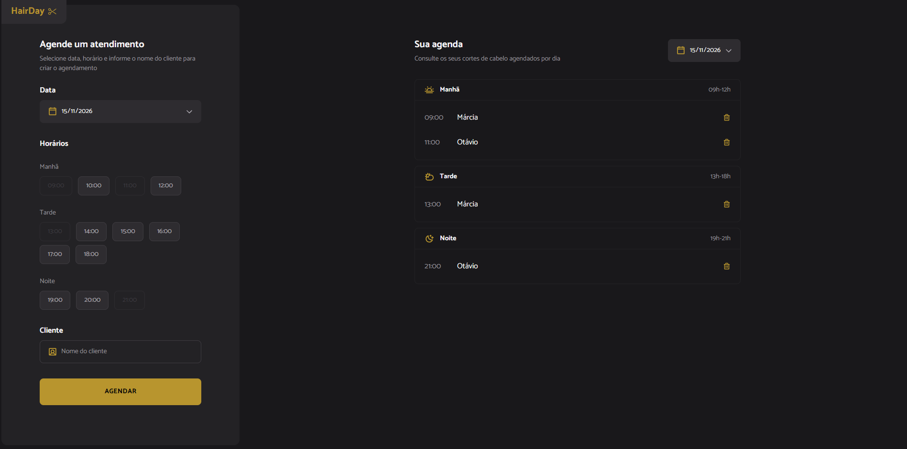
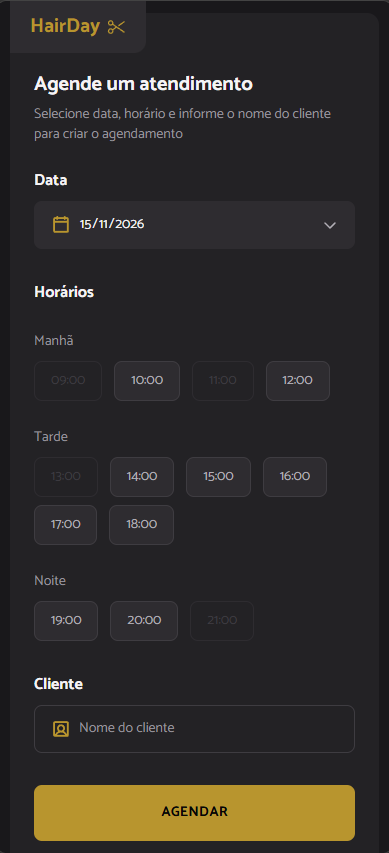
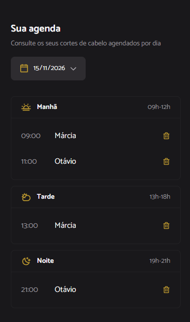

# HairDay 💇‍♂️

**HairDay** é uma aplicação web de agendamento para salão de beleza e barbearia, desenvolvida como projeto de estudo de **React + TypeScript + Vite**.

A interface é dividida em duas áreas:

- **Painel lateral** — formulário para cadastrar um novo agendamento (data, horário e nome do cliente).
- **Agenda do dia** — lista dos atendimentos do dia selecionado, organizada por períodos (Manhã, Tarde e Noite).

O layout segue fielmente o design disponibilizado no Figma, incluindo o Style Guide (cores, tipografia Catamaran e ícones Phosphor).

## ✨ Funcionalidades

- **Cadastro de agendamento**: informe data, horário e o nome do cliente e clique em **Agendar**.
- **Agenda por data**: consulte os agendamentos de qualquer dia usando o seletor de data no cabeçalho da agenda.
- **Agrupamento por período**: os atendimentos são exibidos em Manhã (09h–12h), Tarde (13h–18h) e Noite (19h–21h).
- **Ordenação cronológica**: dentro de cada período, os agendamentos aparecem em ordem crescente de horário.
- **Exclusão individual**: cada agendamento tem um botão de exclusão que o remove imediatamente da lista.
- **Bloqueio de horários ocupados**: um horário que já possui agendamento na data escolhida aparece desabilitado no formulário e volta a ficar disponível quando o agendamento é excluído.
- **Estado vazio**: períodos sem agendamentos exibem a mensagem "Você ainda não tem agendamentos cadastrados nesse período."
- **Validação de campos obrigatórios**: data, horário e nome do cliente são exigidos antes do cadastro.
- **Responsividade**: em telas menores o layout se reorganiza em coluna única, mantendo formulário e agenda utilizáveis.

Os agendamentos ficam em memória (estado do React), conforme o escopo do projeto — não há backend, banco de dados ou autenticação. Ao recarregar a página, a lista volta vazia.

## 🖼️ Screenshots

### Desktop



### Mobile

<p align="center">
  
  
</p>

## 🚀 Tecnologias

- [React 19](https://react.dev/)
- [TypeScript](https://www.typescriptlang.org/)
- [Vite 7](https://vite.dev/)
- [Tailwind CSS 4](https://tailwindcss.com/)
- [@phosphor-icons/react](https://phosphoricons.com/) — ícones da interface
- Fonte [Catamaran](https://fonts.google.com/specimen/Catamaran) (Google Fonts)

## 📋 Pré-requisitos

- [Node.js](https://nodejs.org/) (versão 20 ou superior recomendada)
- npm (incluído com o Node.js)

## 🔧 Instalação

Clone o repositório e instale as dependências:

```bash
npm install
```

## ▶️ Executando em desenvolvimento

```bash
npm run dev
```

O Vite iniciará a aplicação em `http://localhost:5173/`.

Outros comandos disponíveis:

```bash
npm run build    # build de produção (TypeScript + Vite)
npm run preview  # serve o build de produção localmente
npm run lint     # verifica o código com ESLint
```

## 🗂️ Estrutura do projeto

```text
src/
  assets/                 # recursos estáticos
  components/
    AppointmentItem/      # linha de um agendamento (horário, nome, exclusão)
    AppointmentList/      # agenda do dia + seletor de data
    DataInput/            # campo de data reutilizável
    PeriodSection/        # card de período (Manhã/Tarde/Noite) e estado vazio
    ScheduleSidebar/      # painel lateral com o formulário de agendamento
  types/
    appointment.ts        # modelo de dados do domínio
  utils/
    schedule.ts           # períodos, horários fixos, filtro e agrupamento
  App.tsx                 # estado principal e composição da tela
  main.tsx
  index.css               # tokens de estilo (cores, fonte, superfícies)
```

## 📚 Referências

- [Enunciado do projeto (Notion)](https://deluxe-blue-bc1.notion.site/Projeto-04-HairDay-Agendamentos-com-React-TypeScript-IA-414dfca74d8d81919380c39dcde5d2e3)
- [Design no Figma (interface e Style Guide)](https://www.figma.com/design/j8bL9IhyywmoFbLdmLT8mz/Plataforma-de-agendamento--Community---Copy---Copy-)
- [Phosphor Icons](https://phosphoricons.com/)
